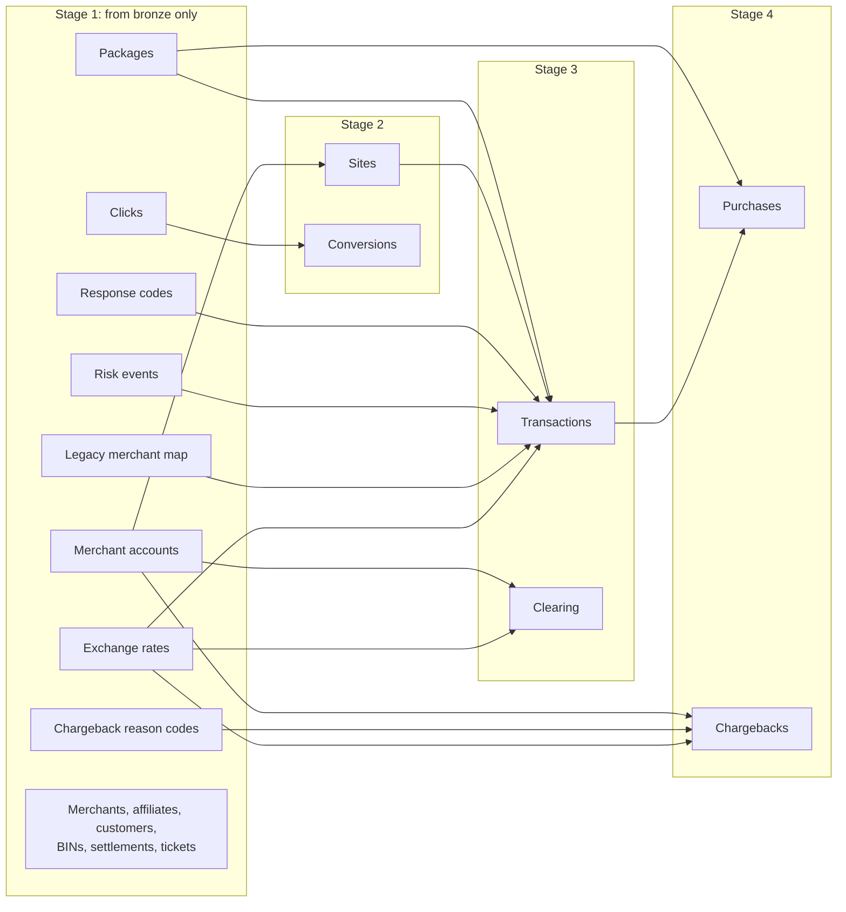

# Data and Transformations in Detail

This page goes one level deeper than the [main README](README.md). It describes:

1. **The original data:** every source file, its format and what it contains.
2. **The cleaning rules shared by all sources.**
3. **What happens to each source on its way to silver**, with real examples of the problems fixed.
4. **How silver becomes gold** for reporting.
5. **Known data issues** that are still open.

Row counts are from the load of 2026-10-15.

> All the data is synthetic: generated to imitate a payment processor's systems. It contains no real people or card numbers. Cards appear only as their first digits (BIN) and last 4 digits.

---

## Contents

- [1. The original data](#1-the-original-data)
- [2. Rules applied to every source](#2-rules-applied-to-every-source)
- [3. From raw to clean, row by row](#3-from-raw-to-clean-row-by-row)
- [4. Source by source](#4-source-by-source)
  - [Merchants, accounts and sites](#merchants-accounts-and-sites)
  - [Packages (pricing)](#packages-pricing)
  - [Customers and purchases](#customers-and-purchases)
  - [Payment transactions](#payment-transactions)
  - [Risk engine decisions](#risk-engine-decisions)
  - [Chargebacks](#chargebacks)
  - [Acquirer clearing files](#acquirer-clearing-files)
  - [Finance: exchange rates and settlements](#finance-exchange-rates-and-settlements)
  - [Affiliate tracking](#affiliate-tracking)
  - [Support tickets](#support-tickets)
  - [Reference lists](#reference-lists)
- [5. How silver becomes gold](#5-how-silver-becomes-gold)
- [6. Known data issues](#6-known-data-issues)

---

## 1. The original data

The files cover **October 2024 to 13 October 2026** and come from 11 systems. No data dictionary came with them, so every column's meaning and quirks were worked out by profiling the data.

| System | Folder | Format | Files | Bronze table(s) | Rows |
|---|---|---|---|---|---|
| Merchant CRM | `crm\` | CSV | merchants_crm_export, merchant_accounts, merchant_xref, sites, affiliates | 5 tables of the same names | 419 / 201 / 138 / 327 / 61 |
| Pricing system | `pricing\` | Pipe-delimited text (`\|`) | packages.txt | packages | 1,101 |
| Billing platform | `billing\` | CSV | customers, purchases_snapshot | customers, purchases_snapshot | 69,019 / 65,819 |
| Payment gateway | `txn\` | CSV, one file per month (26 files) | transactions_YYYYMM | txn_pre_migration, txn_post_migration | 119,215 / 112,184 |
| Risk (fraud) engine | `risk\` | JSON Lines, one file per month (25 files) | risk_events_YYYYMM | risk_events | 83,268 |
| Acquirer chargeback feed | `disputes\` | CSV with every value quoted | chargebacks_acquirer_feed | chargebacks_acquirer_feed | 877 |
| Acquirer clearing | `acquirer_clearing\` | XML, one file per acquirer per month (75 files) | clearing_ACQUIRER_YYYYMM | clearing_transactions | 161,520 |
| Finance / ERP | `finance\` | CSV | fx_rates_daily, settlements_weekly | 2 tables of the same names | 3,484 / 12,023 |
| Affiliate tracker | `affiliate_tracker\` | CSV | clicks, conversions | clicks, conversions | 133,474 / 27,488 |
| Support helpdesk | `support\` | Semicolon-delimited, quoted | helpdesk_tickets | helpdesk_tickets | 13,230 |
| Shared reference | `reference\` | CSV | bin_reference, chargeback_reason_codes, response_codes | 3 tables of the same names | 243 / 16 / 14 |

**What the raw files look like**

Each system has its own conventions. A few lines exactly as they arrive:

```text
pricing\packages.txt (pipe-delimited; price with and without "$", billing model in capitals)
90005|5003|14-Day Trial + Monthly|TRIAL|0.00|USD|14|29.00|30|Active|2023-08-31|2024-02-11
90006|5003|Annual Membership|RECURRING|$79.95|USD||79.95|365|active|2023-08-07|2023-09-20

txn\transactions_202409.csv (old gateway: numeric merchant, US Eastern time, "TRUE")
810000001,4000003,0,1289,5749,92919,C00000001,SALE,1.84,EUR,MASTERCARD,545403,…,2024-09-30 21:51:47,…,TRUE,…

txn\transactions_202604.csv (new gateway: MRC- merchant, UTC with "Z", 8-digit BIN, "N")
810237020,4052319,,MRC-00118,5639,92481,C00022645,REBILL,23.95,USD,VISA,43492692,…,2026-03-01T01:26:55Z,…,N,…

disputes\chargebacks_acquirer_feed.csv (every value quoted, US dates, network prefix on the code)
"CB-2024-000001","Mastercard","MC4853","Cardholder Dispute",…,"10/31/2024","29.96","USD",…,"LOST"

support\helpdesk_tickets.csv (semicolons, day-first dates)
"TKT-700001";…;"Refund Request";"normal";"solved";"25/12/2024 19:13";"27/12/2024 16:52";…
```

```xml
<!-- acquirer_clearing\clearing_PACIFIC_202501.xml -->
<ClearingBatch acquirer="Pacific Merchant Bank" period="2025-01" itemCount="1139">
  <Item><MID>4755068726</MID><AuthDate>2024-12-27</AuthDate><ClearDate>2025-01-01</ClearDate>
        <BIN>220941</BIN><Last4>0664</Last4><Amount ccy="USD" minor="N">9.99</Amount>
        <Interchange>0.28</Interchange><ARN>74248351477266519386142</ARN></Item>
```

```json
// risk\risk_events_202501.jsonl (engine 2.9.1)
{"event_id": "evt_71421d9e93899dd0", "txn_id": 810011654, "score": 38, "decision": "APPROVE",
 "rules_triggered": [{"rule_id": "R110", "rule_name": "PROXY_OR_VPN", "weight": 10}], "signals": {…}}
// risk\risk_events_202605.jsonl (engine 3.1.0: field names changed)
{"event_id": "evt_f1b651f94841fc23", "txn_id": null, "risk_score": 19, "decision": "approve",
 "rules": [], "signals": {…}}
```

**Notes on the files**

- **Two gateways.** The payment gateway was replaced in **March 2026**. Files up to February 2026 use the old layout and files from March onward use the new one. The loader recognizes the layout from the header (`currency` vs. `ccy`) and puts each file in the matching bronze table.
- **Two risk-engine versions.** The engine was upgraded in **February 2026**, and its JSON field names changed (see [Risk engine decisions](#risk-engine-decisions)).
- **Duplicate billing exports.** `billing\` also contains `Customers.tsv` and `Purchases_Snapshot.tsv`: the same data as the CSV files, in a legacy tab-separated layout with different column names (`CustomerID`, `MerchantNo`, …). Only the CSV files are loaded.
- **Merchant history.** The CRM export holds **one row per change** to a merchant (419 rows for 156 merchants), not one row per merchant.
- **Two documents ship with the data:** `docs\README_source_systems.md` (a short description of the systems) and `docs\business_questions.md` (what the reporting should answer).

### How bronze stores it

Bronze keeps every value **as text, exactly as received**, so nothing is lost or misread on the way in. Each row also gets:

| Column | Meaning |
|---|---|
| `source_system` | Which system the row came from |
| `source_file_name`, `source_file_path` | The file it was read from |
| `batch_id` | A unique ID for that load |
| `ingested_at` | When it was loaded (UTC) |
| `ingested_by` | Which account loaded it |

Reloading a file **replaces** the rows previously loaded from that file, so a file loaded twice is never counted twice.

---

## 2. Rules applied to every source

Silver applies the same rules everywhere, using shared functions and mapping tables. A date or a country is read the same way in every table.

### Dates

The sources use at least eight date formats: `2025-04-03`, `04/03/2025`, `03/04/2025`, `Aug 24, 2026`, `20260302`, `2026-03-01T01:26:55Z`, Unix timestamps in seconds or milliseconds, and more.

- Every format is converted to a real date or date-time.
- **Ambiguous slash dates** (`03/04/2025` could be March 4 or April 3):
  1. Where another date in the same record pins it down, that date decides. For example, a settlement's period start must match the date in its ID, and a purchase date must fall within a day of its first payment.
  2. Otherwise the date is read **US style (month first)**.
  3. Day-first is used only when month-first is impossible (`25/12/2024`).
- The helpdesk always writes dates day-first, so its dates are read that way.
- **All times are UTC.** The old gateway recorded US Eastern time. Those times are converted with daylight saving applied, and the conversion was checked against 39 February 2026 transactions that both gateways sent: they match exactly.

### Amounts

- `$79.95`, `1,671.14`, `9,00` (decimal comma) and `(67.95)` (accounting negative) all become real numbers.
- **Signs are consistent.** Refunds, voids and chargebacks are negative in transactions. Refunds are negative in settlements.
- **Converted to US dollars.** Every amount also gets a USD value, using the **US Treasury rate for that day, or the most recent rate before it**. Only the Treasury feed is used (the ECB rates in the same file are not), so every USD figure has the same source. If no rate exists, the USD value is left empty rather than guessed.
- Percentages are stored as fractions: `35%`, `35` and `0.35` all become `0.3500`.

### Text and codes

- **One spelling per value.** Mapping tables translate every variant:
  - `USA`, `U.S.A.`, `United States` → `US`
  - `VI`, `VISA`, `Visa` → `Visa`; `MC`, `MASTERCARD` → `Mastercard`
  - the acquirer names in their various spellings → one name per acquirer
  - When a new spelling turns up, a row is added to the mapping table and no code changes.
- **Statuses and categories** are put in Title Case, and synonyms are merged (`Act`, `A`, `ACTIVE` → `Active`). Distinctions that carry meaning are kept, for example `Closed by merchant` vs. `Closed - terminated`.
- **Yes/no flags** (`Y/N`, `TRUE/FALSE`, `1/0`, `true`) become 1 or 0.
- **Placeholders become empty.** `N/A`, `NULL`, `-`, blank and similar become a true empty value (NULL), never `0` or `"N/A"`, so they don't distort counts and averages.

### Test data

Test merchants (such as `MRC-99999` / legacy `9999`) and test sites (category `Test`, or any site of a test merchant) are listed in one place. Every source drops their rows, and each load records how many it dropped.

### Duplicates

Each silver table has one row per business key: one row per merchant, per transaction, per case, and so on. When the same key arrives more than once, a rule specific to that source picks the winner. Usually it is the latest version or the most recently loaded file; the rule for each source is described below.

### Traceability

Every silver row keeps its bronze file name, batch and load time, plus the ID of the silver run that built it. Any figure can be traced back to the file and load it came from.

### Personal data

Emails, IP addresses and postal codes stay in silver but are **masked** for anyone without permission to see them. They are not carried into gold.

---

## 3. From raw to clean, row by row

Each silver load counts what it read, what it kept, and what it removed and why. These are the counts from the latest run:

| Source | Bronze rows | Silver rows | Removed | Why |
|---|---:|---:|---:|---|
| Merchants (CRM) | 419 | 156 | 263 | 262 older versions of the same merchant; 1 test merchant |
| Merchant accounts (MIDs) | 201 | 201 | 0 | |
| Legacy merchant map | 138 | 137 | 1 | Test merchant |
| Sites | 327 | 325 | 2 | Test sites |
| Affiliates | 61 | 61 | 0 | |
| Packages | 1,101 | 1,095 | 6 | Packages on test sites |
| Customers | 69,019 | 69,019 | 0 | |
| Purchases | 65,819 | 65,497 | 322 | Same purchase exported more than once |
| Transactions | 231,399 | 229,389 | 2,010 | 1,373 duplicates (incl. 39 sent by both gateways); 637 test transactions |
| Risk events | 83,268 | 82,527 | 741 | Exact duplicate events |
| Chargebacks | 877 | 877 | 0 | |
| Clearing items | 161,520 | 161,520 | 0 | |
| Exchange rates | 3,484 | 1,148 | 2,336 | Rates from sources other than the US Treasury |
| Settlements | 12,023 | 11,828 | 195 | Superseded versions of 156 reissued settlements |
| Clicks | 133,474 | 133,474 | 0 | |
| Conversions | 27,488 | 27,488 | 0 | |
| Support tickets | 13,230 | 13,230 | 0 | |
| BIN reference | 243 | 243 | 0 | |
| Response codes | 14 | 14 | 0 | |
| Chargeback reason codes | 16 | 16 | 0 | |

Silver also creates `risk_event_rules` (33,836 rows), with one row per rule fired by a risk event.

The silver tables load in four stages, because some sources use others to fill gaps:



---

## 4. Source by source

For each source: what it is, the problems found in the raw data, and what silver does about them.

### Merchants, accounts and sites

**Merchants** (`crm\merchants_crm_export.csv` → `silver.merchants_crm_export`)

A merchant is a business that sells through SegPay. The CRM records business details, risk tier and contract pricing.

| Raw problem | Example | Silver |
|---|---|---|
| One row per change, not per merchant | 419 rows, 156 merchants | Latest version kept (by `last_modified`) |
| Industry spelled many ways | `SaaS / Software`, `Software/SaaS`, `FITNESS`, `E Learning` | `SaaS`, `Fitness`, `E-Learning` |
| Status spelled many ways | `Act`, `A`, `ACTIVE`, `Term`, `Pending_Review` | `Active`, `Terminated`, `Pending Review` |
| Risk tier in several forms | `1`, `T1`, `Tier 1`, `Low`, `Critical` | `Tier 1` – `Tier 5` (Critical = Tier 5) |
| Fees as % or fraction | `15%`, `0.05` | `0.1500`, `0.0500` |
| MCC missing leading zero | `742` | `0742` |
| `N/A` typed as an email | `N/A` | empty |

**Merchant accounts** (`crm\merchant_accounts.csv` → `silver.merchant_accounts`)

A merchant's processing accounts at the acquiring banks. Each has a **MID** (the bank's ID for the account). Transactions, chargebacks and clearing files carry the MID, and this table links it back to the merchant.

- Acquirer names unified; currency groups tidied (`usd / cad` → `USD/CAD`); MCC padded to 4 digits; status in Title Case.
- One row per MID: the latest `effective_from` wins.

**Legacy merchant map** (`crm\merchant_xref.csv` → `silver.merchant_xref`)

The old gateway identified merchants by number (`1005`); the new one uses `MRC-00002`. This table maps old numbers to new IDs so that 18 months of old-gateway transactions can be linked to the right merchant.

- **Gap found:** legacy merchants `1002`, `1229` and `1310` are not in the map. The risk engine names the new ID on every one of their events, so silver uses that (see [Payment transactions](#payment-transactions)).

**Sites** (`crm\sites.csv` → `silver.sites`)

A site is a website a merchant sells through. Its **billing descriptor** is the text a cardholder sees on their bank statement.

| Raw problem | Example | Silver |
|---|---|---|
| URLs in different forms | `https://emberhub.com/`, `www.emberpro.com` | `emberhub.com`, `emberpro.com` |
| Descriptor prefix varies | `Segpay *Bluehub`, `Segpay.Com*Novaplus` | `SEGPAY*BLUEHUB`, `SEGPAY*NOVAPLUS` |
| Status casing | `CLOSED`, `Closed` | `Closed` (Live, Active, Paused, Under Review etc. kept distinct) |
| Leading spaces | `' Pixel Pass'` | `Pixel Pass` |

**Affiliates** (`crm\affiliates.csv` → `silver.affiliates`)

Partners who send customers to merchant sites for a commission. Commission arrives as `35%`, `0.3` or `15`, and all become fractions (`0.3500`, `0.3000`, `0.1500`). Countries are mapped to ISO codes.

### Packages (pricing)

`pricing\packages.txt` → `silver.packages`

A package is a price point on a site: a one-time purchase, a recurring membership, or a trial that converts into a membership.

| Raw problem | Example | Silver |
|---|---|---|
| Billing model spelled 11 ways | `TRIAL`, `RECURRING`, `one time`, … | `One-Time`, `Recurring`, `Trial` |
| Price formats | `$79.95`, `9,00` | `79.95`, `9.00` |
| Rebill period in words | `30d`, `monthly`, `3 months`, `yearly` | `30`, `90`, `365` days |
| Status casing | `active`, `Active` | `Active` / `Retired` |

### Customers and purchases

**Customers** (`billing\customers.csv` → `silver.customers`)

One row per cardholder account.

- Countries mapped (`U.S.A.` → `US`). Emails lowercased. Postal codes kept as text so leading zeros survive.
- `created_at` arrives as `2024-10-01`, `Aug 24, 2026` or `24/08/2026`. All are read. Before the refactor, 3,230 customers had no creation date.
- **Marketing consent** becomes 1 (yes), 0 (no) or empty (never asked). Empty means **do not market**.

**Purchases** (`billing\purchases_snapshot.csv` → `silver.purchases_snapshot`)

A purchase is a customer's order or subscription for one package. The file is a snapshot of each purchase's state at export time.

| Raw problem | Example | Silver |
|---|---|---|
| Status spelled 26 ways | `CANCELLED`, `X`, `Closed`, … | `Active`, `Past Due`, `Cancelled`, `Expired`, `Completed`, `Chargeback` |
| Cancel reason spelled ~40 ways | `cust requested cancel`, `CUSTOMER_REQ` | 12 standard reasons (`Fraud` and `Fraud Suspected` kept apart) |
| Ambiguous dates | `04/05/2026` | Checked against the purchase's first payment or its last update (9,891 dates resolved this way) |
| Trial flag often blank | `''` | Filled from the package's billing model (11,640 rows). Where both are present they always agree. |
| Same purchase exported twice | 322 extra rows | Latest update wins; on a tie, the later lifecycle state |

Declined first attempts never become purchases, so some purchase IDs in transactions have no purchase row. That is expected.

### Payment transactions

`txn\transactions_YYYYMM.csv` → bronze `txn_pre_migration` + `txn_post_migration` → **one** `silver.transactions`

Every payment event: sale, rebill, authorization, zero-amount card check, refund, void and chargeback. This is the largest and most important source, and the gateway change makes it the hardest.

**The two gateway layouts, side by side**

| Old gateway (to Feb 2026) | New gateway (from Mar 2026) | Silver |
|---|---|---|
| `currency` | `ccy` | `currency` |
| `auth_timestamp`, US Eastern, 3 formats | `txn_ts_utc`: ISO with `Z`, `+00:00`, or epoch seconds | `txn_ts_utc`, always UTC |
| `merchant_id` = `1289` (number) | `merchant_id` = `MRC-00118` | `merchant_id` (MRC-) + `legacy_merchant_id` |
| `card_bin`: 6 digits | `card_bin`: 8 digits | `card_bin` + `card_bin6` (first 6, for card lookups) |
| `parent_txn_id` = `0` for "none" | empty | empty |
| (none) | `network_txn_id` | `network_txn_id` |
| Flags `TRUE` / `false` | Flags `Y` / `N` | 1 / 0 |

**Other fixes**

- **Transaction type:** 25 spellings → `Sale`, `Rebill`, `Auth`, `Zero Auth`, `Refund`, `Void`, `Chargeback`.
- **Amount sign:** the old gateway's refunds were sometimes positive. In silver, refunds, voids and chargebacks are always negative.
- **Currency codes:** numeric codes are translated (`840` → USD, `978` → EUR, `826` → GBP, `036` → AUD, `124` → CAD).
- **Response descriptions:** each response code gets one standard description from the reference list. The gateway's own wording is kept in a separate column.
- **Merchant for old transactions:** mapped through the legacy merchant map. For the 3 legacy merchants missing from it, the merchant the risk engine names is used, but only if every risk event for that merchant agrees. These 9,268 rows are flagged `merchant_id_inferred = 1`.
- **Site:** when a transaction's site ID isn't a real site, the site that owns the package is used. These 474 rows are flagged `site_id_inferred = 1`. Wherever both are present, the package's site always matches the transaction's site.
- **Unknown IP country:** `XX` becomes empty.
- **Test transactions** (637) are removed: flagged as test, on a test merchant, or on a test site.
- **Duplicates** (1,373): one row per transaction ID. The new gateway's copy is preferred, then the latest export. This covers 39 February 2026 transactions that both gateways sent.

Result: **229,389 transactions** (118,076 old gateway, 111,313 new), each tagged with which gateway it came from.

### Risk engine decisions

`risk\risk_events_YYYYMM.jsonl` → `silver.risk_events` + `silver.risk_event_rules`

The fraud engine scores each first payment attempt from 1 (low risk) to 99. It then approves (1–64), sends for review (65–87) or declines (88–99), and lists the rules that fired and the signals it used.

The engine upgrade in **February 2026** changed the JSON:

| Engine 2.9.1 (Oct 2024 – Jan 2026) | Engine 3.1.0 (Feb 2026 onward) |
|---|---|
| `score` | `risk_score` |
| `rules_triggered`: list of `{rule_id, rule_name, weight}` | `rules`: list of `"R130:PREPAID_BIN"` strings, no weight |
| `signals.device_id` | `signals.device_fp` |
| `decision`: `APPROVE` | `decision`: `approve` |

Silver reads both versions into the same columns (43,862 old-engine and 38,665 new-engine events). Each fired rule becomes a row in `risk_event_rules`; the weight is empty for 3.1.0. 2,476 events have no signals block, and 6,545 are attempts that never became a transaction. 741 exact duplicate events are removed.

### Chargebacks

`disputes\chargebacks_acquirer_feed.csv` → `silver.chargebacks_acquirer_feed`

A chargeback is a cardholder disputing a charge through their bank. The acquirer's feed lists each case with its reason, amount, deadlines and outcome.

| Raw problem | Example | Silver |
|---|---|---|
| Network prefix on reason codes | `VI-13.2` | `13.2` (the network is in its own column) |
| Hidden characters in codes | invisible spaces | removed |
| Network spelled differently | `VISA`, `Visa` | `Visa` |
| Accounting-style amounts | `(67.95)` (45 cases) | `67.95` (dispute amounts are always positive) |
| Status/outcome in capitals | `LOST` | `Lost` |

- Reason category and description are taken from the reference list, matched on network + code, or on the description if the code doesn't match.
- The merchant is found through the MID. Every MID in the feed is a known merchant account.
- Amounts are converted to USD at the rate on the original sale date.
- `is_representment_sent` = 1 when the merchant sent evidence to fight the case.

### Acquirer clearing files

`acquirer_clearing\clearing_ACQUIRER_YYYYMM.xml` → `silver.clearing_transactions`

The acquiring banks' record of every sale they settled, with the **interchange** fee paid to the card issuer. Three acquirers send one XML file per month. Clearing data is used to reconcile what was authorized with what was actually cleared.

- **Minor units:** some amounts arrive in cents (`minor="Y"`, `2995` = 29.95). They are converted using each currency's decimal places: 2 for most, 0 for JPY/KRW, 3 for KWD/BHD. If the unit flag is missing or unrecognized, the amount is left empty rather than guessed.
- Acquirer names unified; merchant found via the MID; amount and interchange converted to USD at the authorization-date rate.
- One row per **ARN** (the reference number that also links chargebacks to the sale).

### Finance: exchange rates and settlements

**Exchange rates** (`finance\fx_rates_daily.csv` → `silver.fx_rates_daily`)

- The file mixes two rate providers, the ECB and the US Treasury, often for the same day and pair with slightly different rates. **Only the US Treasury feed is kept** (1,148 of 3,484 rows).
- Pairs come both ways (`GBPUSD` and `USDCAD`). Silver stores each currency as **USD per 1 unit** and its inverse, so any amount converts with one multiplication.

**Weekly settlements** (`finance\settlements_weekly.csv` → `silver.settlements_weekly`)

A settlement is the weekly statement of what SegPay pays a merchant for a Monday–Sunday period:

```text
net payout = gross sales − refunds − chargebacks − fees − reserve held + reserve released + adjustments
```

- Ambiguous dates are resolved from the settlement ID, which contains the period start (`STL-20240930-…`). The period end must be 6 days later, and the payout 1–14 days after that.
- Refunds arrive with mixed signs (`-23.95`, `7.99`, `$-0.00`) and are stored as negative so the formula above holds.
- Payout status unified: `PAID`/`Complete` → `Paid`, `On Hold` → `Held`, `Returned by bank` → `Returned`.
- **Reissued settlements:** 156 settlements were reissued with a higher version number (for example after a fee correction). Only the latest version is kept, so 195 older versions are removed.
- `payout_reconciles` = 1 when the net payout equals the formula (within 2 cents). **42 settlements do not reconcile.** They are kept as sent and flagged for finance.

### Affiliate tracking

**Clicks** (`affiliate_tracker\clicks.csv` → `silver.clicks`)

- Timestamps arrive as Unix milliseconds (`1787676709000`) and become UTC date-times.
- The tracker's `publisher_id` (`5`) is translated to the affiliate ID used everywhere else (`AFF-0005`). This was verified against all 23,373 clicks that led to a purchase.
- Browser family → device (Mobile / Desktop). Bot and unknown traffic is flagged `is_bot = 1`.

**Conversions** (`affiliate_tracker\conversions.csv` → `silver.conversions`)

A conversion is a click that led to a sale. Timestamps are converted from milliseconds, and `order_id` links to the purchase. Event and status are capitalized (`sale` → `Sale`, `approved` → `Approved`).

### Support tickets

`support\helpdesk_tickets.csv` → `silver.helpdesk_tickets`

- Semicolon-separated, and dates are **always day-first** (`25/12/2024 19:13`).
- The order reference `SP-4140960` becomes purchase ID `4140960`. All 8,650 referenced orders exist in purchases and transactions.
- **Resolution time** is calculated in minutes from creation to solve.
- Agents `agent_unassigned` → `Unassigned`. Channels: Email / Phone / Chat / Web Form. Tags tidied to lowercase, `|`-separated.

### Reference lists

| Source | What it is | Main fixes |
|---|---|---|
| `bin_reference.csv` | Card BIN (first 6 digits) → brand, credit/debit/prepaid, tier, issuing bank and country | Brands unified (`MASTERCARD` → `Mastercard`); `C`/`D`/`P` → Credit/Debit/Prepaid; country suffix removed from bank names (`Capital Credit Union DE` → `Capital Credit Union`); one row per BIN, latest update wins |
| `response_codes.csv` | Issuer answers to a payment request (`00` Approved, `51` Insufficient funds, …) | Descriptions in Title Case, abbreviations kept (`CVV2 / CVC2 Failure`) |
| `chargeback_reason_codes.csv` | Network reason codes with a category | Network names unified; a code is unique only within its network |

---

## 5. How silver becomes gold

Gold reorganizes silver into a **star schema**: events (**facts**) in the middle, linked to the things that describe them (**dimensions**). See the [gold README](SQL/gold/README.md) for the full table list.

### Dimensions

| Dimension | Built from | Notes |
|---|---|---|
| Date | generated | Every day 2017–2030, with week, month, quarter and year |
| Merchant | merchants + every merchant ID seen elsewhere | **Keeps history** (see below) |
| Merchant account, site, package, affiliate, card BIN, chargeback reason | the matching silver table | Latest values |
| Customer | customers | **No email or postal code.** Personal data stays in silver |
| Response code | response codes + a business rule table | Each code classed as **Approved**, **soft decline** (worth retrying, e.g. insufficient funds) or **hard decline** (don't retry, e.g. stolen card) |

Every dimension has an **Unknown** row. A fact whose site, package, BIN and so on isn't recognized links to Unknown instead of being dropped, so totals always match silver. Rows that disappear from silver are flagged as deleted, never removed.

### Merchant history

When a merchant's **status, risk tier, industry, MCC, reserve or any fee** changes, gold closes the old version and opens a new one, each with its validity dates. Each transaction and chargeback links to the version **in effect on its date**. Corrections to names, country, onboarding date or account manager overwrite every version instead, because they fix mistakes rather than record change.

Merchants referenced by transactions or sites but missing from the CRM are added as placeholders and filled in when the CRM sends them. The CRM file holds only current values, so history builds up from the first gold load on **2026-10-15**.

### Facts

**Transactions** (`gold.fact_transaction`, 229,389 rows): one row per payment event, with:
- `amount_usd` (signed: refunds negative)
- `is_approved`, and `is_revenue` (an approved sale or rebill)
- `revenue_usd`
- the risk engine's score and decision for that transaction
- the inferred-merchant and inferred-site flags from silver

**Chargebacks** (`gold.fact_chargeback`, 877 rows): one row per case, with:
- the USD amount, and won / lost / open flags
- **days from sale to dispute**, days allowed to respond, and days to resolution
- the disputed transaction's site, package, customer and affiliate, when the transaction is found (829 of 877 cases)

### Chargeback monitoring

`gold.agg_chargeback_monitoring` calculates each merchant's **chargeback ratio per card network per month**. It does this two ways:
- **Visa style:** this month's chargebacks ÷ this month's sales.
- **Mastercard style:** this month's chargebacks ÷ last month's sales.

It compares the ratio with the networks' monitoring thresholds and flags a warning or breach. It is a view, so it is always current, and a change to a threshold applies immediately. **The thresholds are illustrative**: confirm the networks' current rules before acting on them.

### Checks on every build

Gold totals are compared with silver on every load: transaction value, approved revenue and chargeback value must match to the cent. Every step records how many rows linked to an Unknown dimension, so a new data gap shows up in the load log straight away.

---

## 6. Known data issues

These issues come from the source data, not from the loading. Each is counted on every load, so a change shows up in the load log.

| Issue | Size | How it's handled |
|---|---|---|
| Sites linked to merchants `MRC-00201`–`MRC-00205`, which have no accounts; their purchases and transactions name a different merchant | 12 sites, 1,951 purchases | Loaded as received; the purchase's merchant is used for purchases. **Awaiting a business decision on the correct owner.** |
| Card BIN not in the reference list | 14,761 transactions (plus 3,331 with no BIN, e.g. wallet and SEPA payments) | Shown as Unknown card type in gold (18,092 in total) |
| Chargeback reason code not in the reference list | 123 cases | Shown as Unknown reason in gold |
| Old-gateway merchants missing from the legacy map | 3 merchants, 9,268 transactions | Merchant taken from the risk engine; flagged `merchant_id_inferred` |
| Transaction site isn't a real site | 474 transactions | Site taken from the package; flagged `site_id_inferred`. About 10 have no usable package and show as Unknown. |
| No exchange rate for the currency/date | 1,864 transactions | USD value left empty |
| Transaction amount missing | 471 transactions | Left empty |
| Settlements whose net payout doesn't match its parts | 42 settlements | Kept as sent; flagged `payout_reconciles = 0` |
| Packages dated in the future | 47 packages | Kept as sent |
| Package updated before it was created (ambiguous date read US style) | 7 packages | Kept; the source mixes date styles |
| Sites launching in the future | 4 sites | Kept as sent |
| Purchase cancelled a few days before it was made | 70 purchases | Kept as sent |
| Merchant country not recognized | 1 merchant | Left empty |

---

*Technical detail for developers (procedures, deployment, monitoring queries) is in [SQL/README.md](SQL/README.md) and the README in each layer's folder.*
