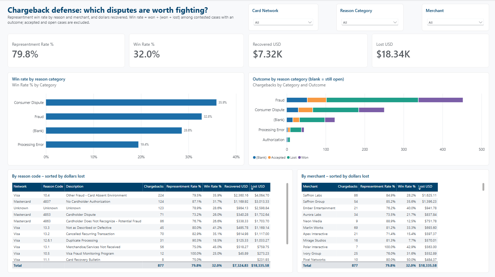
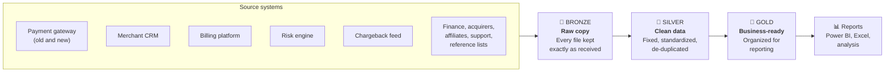
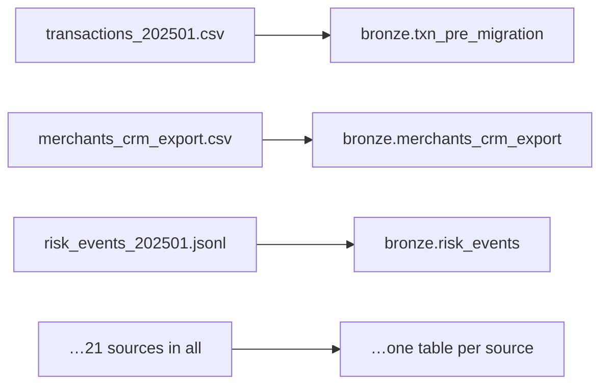
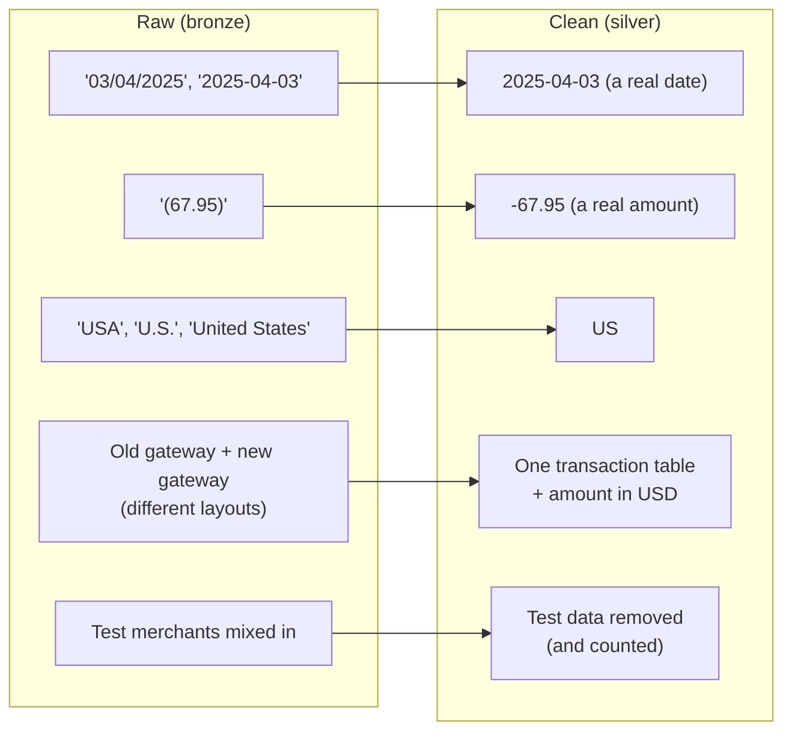
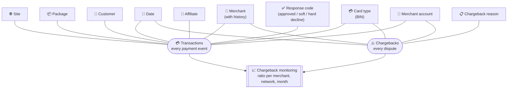
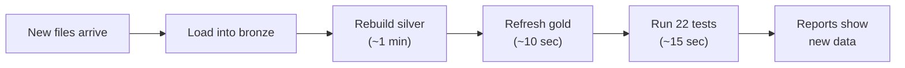

# SegPay Data Warehouse

## Project overview

This project builds a complete data warehouse and reporting solution for **SegPay**, a payment processor for subscription businesses. It takes raw exports from 11 source systems, cleans and combines them in SQL Server, and turns them into a Power BI report. The result is one trusted place to answer business questions: how much SegPay processes, how much it earns, how often payments are approved, and which merchants are at risk from chargebacks.

| | |
|---|---|
| **Sources** | 11 systems (payment gateway, merchant CRM, billing, risk engine, chargeback feed, acquirer clearing files, finance, affiliate tracker, support desk, reference lists); 147 files in CSV, pipe-delimited, TSV, XML and JSON Lines formats |
| **Volume** | About 804,000 raw rows, covering October 2024 to October 2026 |
| **Design** | Medallion architecture: **bronze** (raw copy) → **silver** (cleaned and standardized) → **gold** (star schema for reporting) |
| **Built with** | SQL Server 2025 (T-SQL stored procedures), PowerShell, Power BI (DAX, Power BI project format), Git and GitHub |
| **Deliverables** | 21 bronze tables; 21 cleaned silver tables with load logging; a gold star schema with 10 dimensions, 2 fact tables and a chargeback-monitoring view; a Power BI report with 28 measures; change auditing with SQL Server triggers |

**What this project demonstrates:**
- **Data cleaning at scale:** two payment-gateway layouts merged into one, eight date formats, inconsistent spellings, duplicates and test data, every fix counted and logged.
- **Dimensional modeling:** a star schema with merchant history (slowly changing dimension type 2) and an "Unknown" member, so no transaction drops out of a total.
- **Reliable loading:** one command refreshes everything in order, re-running is safe, and every step records what it loaded, removed and why.
- **Automated testing:** 22 tests run after every refresh, from the cleaning rules to gold-to-silver reconciliation, and fail the run if anything is wrong.
- **Audit trail:** SQL Server triggers record every hand-made change to the business rules and every change to the database code: who, when, and what it was before.
- **Business reporting:** chargeback ratios defined the way the card networks measure them, and a dashboard that shows which disputes are worth fighting.

> The data in this project is synthetic. It imitates the data a payment processor receives from its systems and partners. It contains no real customers or card numbers.

---

## Chargeback Analysis Dashboard

The end result of the warehouse is a Power BI report. The screenshot below is the report's **Chargeback Defense** page, taken in Power BI Desktop. It answers one question: **which chargebacks are worth fighting?**



- **Top row:** how often merchants contest a chargeback (79.8%), how often they win when they do (32.0%), and the dollars recovered vs. lost.
- **Charts:** win rate and outcome by reason category. Processing-error disputes are contested most often but won least (19.4%), so fighting them is mostly wasted effort.
- **Tables:** the same measures for each reason code and each merchant, sorted by dollars lost.
- **Filters:** card network, reason category and merchant.

The colors follow SegPay's brand, and the chart colors are checked to stay distinguishable for colorblind readers.

> **Note:** Unfortunately, the report isn't available online yet; I wasn't able to publish it to the Power BI service for now. Until it is, the screenshot shows what it looks like. The full report is in this repository (`Power BI\SegPay.pbip`) and opens in Power BI Desktop for anyone with access to the database.

The rest of this page explains how the data behind the report is collected, cleaned and organized.

---

## The problem it solves

SegPay's data arrives from **11 different systems**, each in its own format and with its own quirks:

- The payment gateway was replaced partway through, so transactions come in two different layouts.
- Dates are written several ways ("03/04/2025": March 4 or April 3?).
- Countries, card brands and acquirers are spelled differently from file to file.
- Refunds sometimes appear as "(67.95)" instead of "-67.95".
- Test merchants and test sites are mixed in with real activity.
- Merchant records are exported as several copies, one per change.

Reporting directly from these files gives different answers depending on who builds the report. The warehouse cleans and combines the data **once**, the same way every time, so everyone works from the same numbers.

---

## How the data flows

The warehouse uses the industry-standard **bronze → silver → gold** design. Each layer has one job, and data moves through them in order.



| Layer | Think of it as… | What happens here | Who uses it |
|---|---|---|---|
| 🥉 **Bronze** | The filing cabinet | Every source file is stored exactly as it arrived, with a note of when it was loaded and from which file. Nothing is changed, so we can always go back to the original. | Data team (audits, investigations) |
| 🥈 **Silver** | The cleaned-up records | Data is corrected and made consistent: real dates and amounts, one spelling per country or card brand, duplicates and test data removed, both gateways combined into one transaction list. | Data team, analysts with detailed questions |
| 🥇 **Gold** | The reporting shelf | Data is organized around business questions, with all amounts in US dollars and history kept where it matters. | Business users, dashboards |

---

## What happens in each layer

### 🥉 Bronze: keep the original



- One table per source. Every value is stored as text, just as received.
- Each row records **which file it came from** and **when it was loaded**.
- Loading the same file again doesn't create duplicates.

### 🥈 Silver: fix and standardize



The main fixes in silver:

- **Dates and times:** every date format is read correctly. The old gateway recorded US Eastern time, so its times are converted to UTC to match the new one.
- **Money:** amounts become numbers, and every amount also gets a **US-dollar value** using that day's exchange rate (or the latest rate before it).
- **Consistent names:** one spelling for each country, card brand, acquirer and status.
- **Missing values stay empty:** a missing value is left blank, never filled with "N/A" or 0, so it can't distort averages or totals.
- **Duplicates and test data are removed.** Every load records how many rows were removed and why.
- **Personal data is protected:** emails, IP addresses and postal codes are masked for anyone without permission to see them.

Every fix, source by source, is listed in [Data and Transformations in Detail](DATA_DETAILS.md).

### 🥇 Gold: organize for reporting

Gold uses a **star schema**, the standard layout for business reporting. Each event (a payment or a chargeback) sits in the middle and links to the things that describe it.



- **Facts** (the circles) are the things that happen: transactions and chargebacks, with their amounts.
- **Dimensions** (the boxes) are the ways you slice them: by date, merchant, card type and so on.
- **Merchant history is kept.** If a merchant's risk tier or pricing changes, the old version is kept. A sale from March is reported against the risk tier the merchant had in March, not today's. (History starts from 2026-10-15, when the warehouse went live.)
- **Nothing silently disappears.** If a transaction refers to a site or package we have no record of, it is shown under **"Unknown"** instead of being dropped from the totals.

---

## By the numbers

| | Raw (bronze) | Clean (silver) | Reporting (gold) |
|---|---|---|---|
| Payment transactions | 231,399 rows (two gateway formats) | 229,389 (one combined table) | 229,389 |
| Merchants | 419 rows (one copy per change) | 156 merchants | 156 merchants, with change history |
| Customers | 69,019 | 69,019 | 69,019 (no personal details) |
| Chargebacks | 877 | 877 | 877 |

An automated test checks gold totals against silver after every refresh: **$7.38M** in transaction value, **$5.73M** in approved sales and rebills, and **$28.7K** in chargebacks, matching to the cent.

---

## Questions it answers today

| Area | Example questions |
|---|---|
| **Volume and revenue** | What did we process this month, by merchant, vertical or currency? How much is new sales vs. rebills? |
| **Approvals and declines** | What share of payments are approved, by card brand, card type or issuer country? Which declines are worth retrying (soft) and which are not (hard)? |
| **Chargebacks** | Which merchants are close to the Visa or Mastercard monitoring thresholds, and in which month? How long after the sale do disputes arrive, and how many do we win? |

### Coming next

- **Subscription health:** trial-to-paid conversion, rebill success, retention and churn
- **Finance:** do gateway, settlement statements and acquirer clearing files agree?
- **Affiliate quality:** which traffic sources bring fraud or chargebacks?
- **Risk engine:** does the risk score predict chargebacks? Which rules work?
- **Support:** do support tickets predict chargebacks or churn?

---

## Keeping it up to date

A single command refreshes everything, in order:



```powershell
& ".\PowerShell scripts\Load-All.ps1" -LoadGold
```

Every step is logged: start and end time, rows loaded, rows removed and why, and any error. If a step fails, the steps after it don't run, so reports keep showing the last good data instead of half-loaded data.

### Automated tests

After each refresh, 22 automated tests check that the numbers can be trusted. If any test fails, the refresh is reported as failed, with the test's name and what it found.

| Area | What the tests check |
|---|---|
| Cleaning rules | Every date, amount, yes/no and "no value" format found in the source files is read correctly. For example, "03/04/2025" becomes March 4, "(67.95)" becomes −67.95, and "N/A" becomes empty. |
| Raw → clean | Every raw row is accounted for (kept, removed as test data, or removed as a duplicate), no test merchant slips through, refunds are negative, and no "N/A" text is left behind |
| Reporting | Gold totals match silver to the cent, every transaction links to a real date and merchant, merchant history has no gaps or overlaps, and the chargeback summary agrees with the detail |
| Safeguards | The change-recording triggers are in place and actually record changes |

The tests were themselves tested: deliberately breaking the data (a one-cent change, a test merchant left in, a positive refund) made the matching test fail with a message pointing at the problem.

The first full run with tests found a real problem: a redeploy earlier that day had quietly stopped the acquirer clearing files from loading. It's now fixed, and a new test makes sure it can't happen again unnoticed.

The tests run after the data is loaded. If one fails, the reports already show the new data, so check the failure before relying on them.

### Every change is on record

Some numbers depend on rules people maintain by hand: which spellings mean the same country, which merchants are test accounts, and the card networks' chargeback thresholds. Changing one of those rules changes the reports, so the database records each change automatically, using **triggers** (small programs SQL Server runs whenever a table changes):

| What changed | What's recorded |
|---|---|
| A business rule (added, edited or removed) | Who, when, from which application, and the rule before and after |
| The database's code or structure (a table, report view or procedure created, changed or removed) | Who, when, and the exact change |
| A refresh | Rows loaded, rows removed and why, and any error |

So if a merchant's chargeback warning appears or disappears, it's possible to tell whether the merchant's numbers changed or the threshold did.

---

## Good to know

- **Chargeback thresholds are examples.** The Visa and Mastercard monitoring limits in the warehouse are approximations for illustration. Confirm the current rules with the acquirers before acting on the warnings.
- **Known data issue:** 12 sites appear to be linked to the wrong merchant in the CRM (merchants MRC-00201 to MRC-00205). They are loaded as received until the business confirms the correct owner.
- **Data quality gaps show as "Unknown":** for example, about 18,000 transactions use a card BIN that isn't in the reference list, and 123 chargebacks have an unrecognized reason code. These are gaps in the source data, not loading errors.

---

## Project folders

| Folder | Contents |
|---|---|
| `AI generated data\` | The original source files, exactly as received |
| `PowerShell scripts\` | The loader that brings files into bronze and runs every layer |
| `SQL\bronze`, `SQL\silver`, `SQL\gold` | The database code for each layer, each with its own technical README |
| `SQL\audit` | The triggers and tables that record every change (technical README included) |
| `SQL\tests` | The automated tests (technical README included) |
| `Power BI\` | The Power BI report and the SegPay color theme |
| `docs\images\` | Screenshots used in this README |
| `logs\` | A log of every refresh (not stored in GitHub) |

**Want more detail?** [Data and Transformations in Detail](DATA_DETAILS.md) describes every source file, the problems found in each, how each is cleaned, how many rows are kept or removed and why, and the known data issues.

Technical details for developers are in [SQL/README.md](SQL/README.md).
